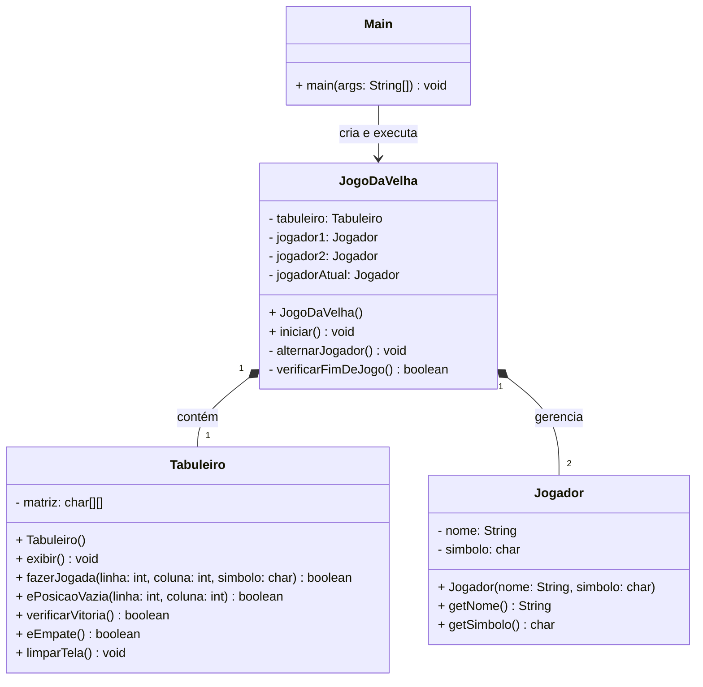

# ❌⭕ Jogo da Velha em Java (CLI)

Um jogo da velha clássico desenvolvido em Java para execução direta no terminal, criado para a disciplina de Linguagem de Programação Orientada a Objetos (LPOO).

O projeto conta com interface em linha de comando otimizada com atualização dinâmica de tela (ANSI Escape Codes) e atalho de execução para Windows.

---

## 🎮 Como Jogar (Download da Release)

Você não precisa ter o IntelliJ instalado para jogar. A forma mais simples é baixar o executável pronto:

1. Acesse a seção de **[Releases](../../releases)** na barra lateral direita deste repositório.
2. Na versão mais recente (ex: `v1.0.0`), baixe os arquivos:
   * `JogoDaVelha_LPOO-main.jar`
   * `Jogar.bat`
3. Coloque ambos os arquivos na **mesma pasta**.
4. Dê um **duplo clique em `Jogar.bat`** para iniciar a partida imediatamente.

---

## 🖥️ Execução Manual via Terminal

Caso prefira rodar o jogo diretamente pelo PowerShell ou Prompt de Comando (CMD):

```cmd
java -jar JogoDaVelha_LPOO-main.jar
```

## 📐 Diagrama de Classes (UML)


